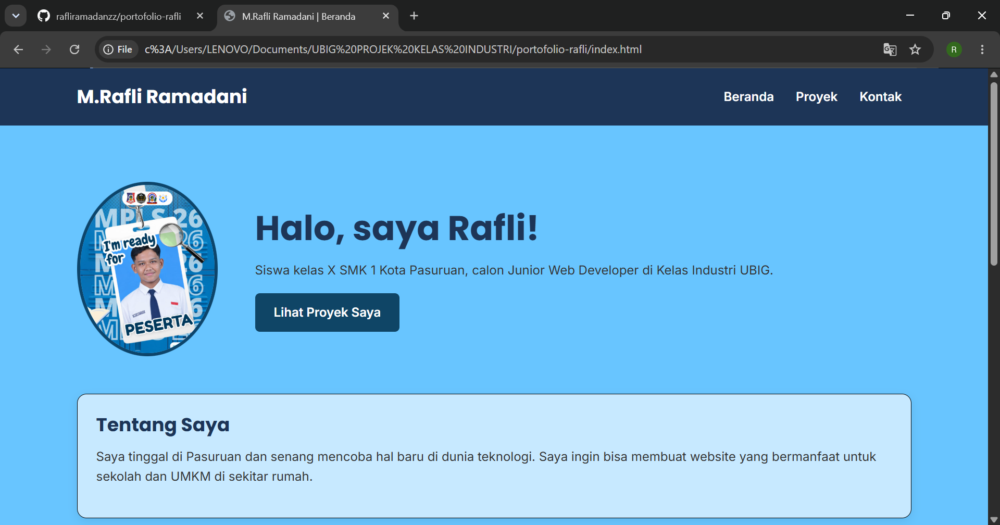

# Portofolio M.Rafli Ramadani
Website portofolio pribadi yang saya buat di Kelas Industri UBIG (Paket 1, Minggu 01 sampai 09).

Website ini menampilkan profil, keahlian, proyek, dan informasi kontak saya. Website dirancang responsif agar nyaman digunakan melalui ponsel, tablet, maupun laptop
## Tampilan

## Fitur
- Halaman **Beranda** berisi profil, hobi, cita-cita, keahlian, dan
jadwal belajar
- Halaman **Proyek** berisi daftar proyek dalam bentuk kartu
- Halaman **Kontak** berisi form untuk menghubungi saya
- Tampilan responsif dengan Flexbox dan *media query*
## Teknologi
- HTML5
- CSS3 (Flexbox dan media query, dan CSS variables)
- JavaScript
- JSON
- Git dan GitHub
- GitHub API
## Pengujian Lightouse
Pengujian website dilakukan menggunakan Lighthouse untuk memeriksa:

- Performance
- Accessibility
- Best Practices
- SEO
## Tautan
- https://portofolio-rafli-ramadani.vercel.app
- Dibuat oleh: M.Rafli Ramadani, SMK 1 Kota Pasuruan Mitra
